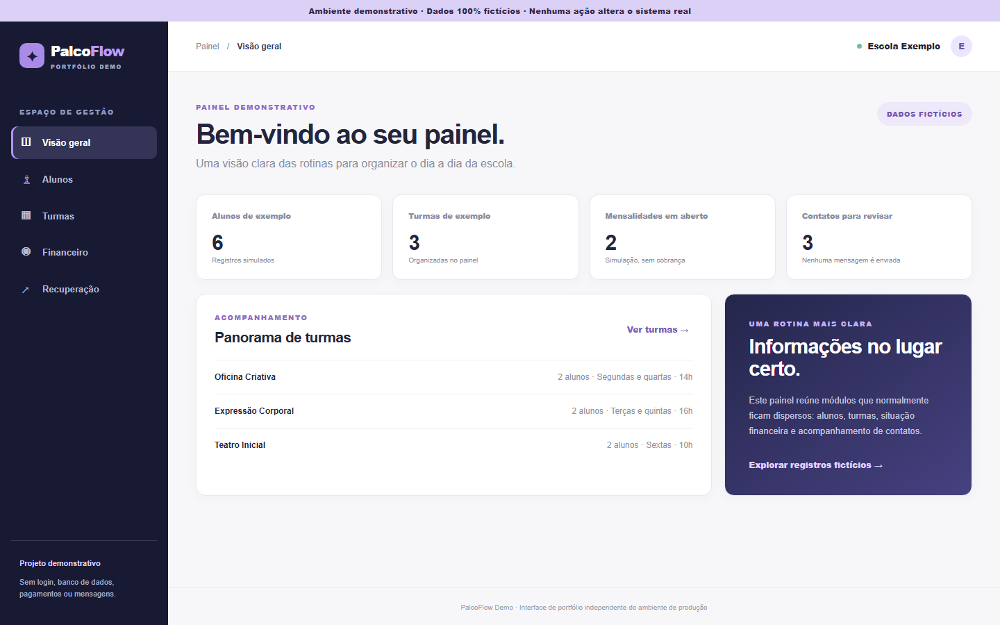

# PalcoFlow - demonstração pública de portfólio

Interface de demonstração independente inspirada no trabalho de desenvolver o PalcoFlow. **Não é o sistema de produção nem uma cópia do banco de dados.** Todos os registros, valores e eventos são fictícios e vivem apenas no código desta página.

## O que esta versão mostra

- Painel com métricas calculadas a partir de registros de exemplo.
- Consulta de alunos, turmas e situação financeira ilustrativa.
- Fila visual de recuperação com filtros, sem contato ou envio de mensagens.
- Layout responsivo, navegação por teclado e tabelas semânticas.
- Nenhuma autenticação real, API, Supabase, pagamento ou dado pessoal.

## Executar localmente

Abra `index.html` diretamente ou sirva a pasta com `python -m http.server 8000` e acesse `http://localhost:8000`.

## Separação do projeto real

O PalcoFlow de produção usa uma arquitetura mais ampla com Next.js e Supabase, regras de acesso e fluxos próprios. Esta vitrine estática mostra a experiência de interface sem expor implementação, configuração, credenciais ou registros de produção. Não use esta demonstração para gerir uma escola real.
